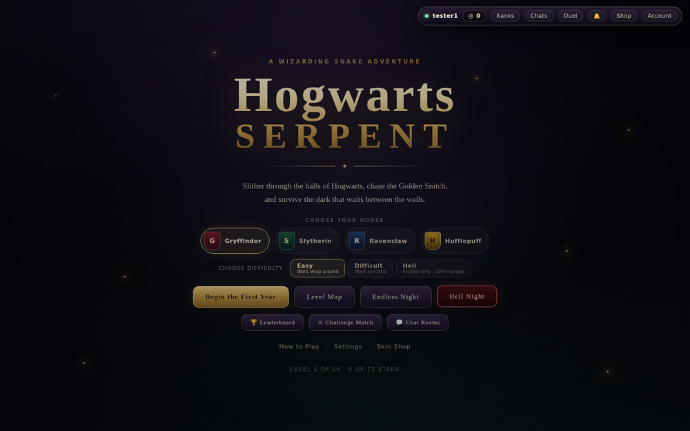
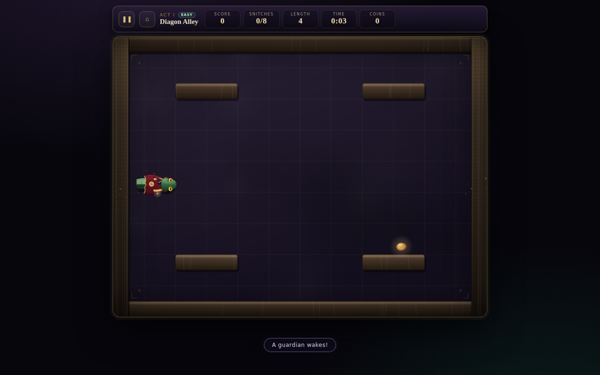
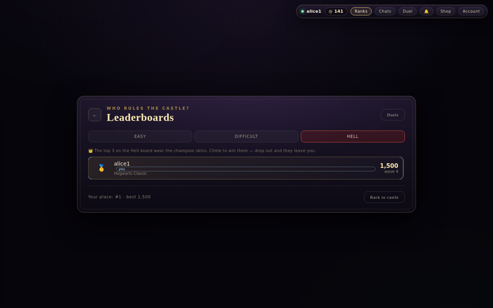
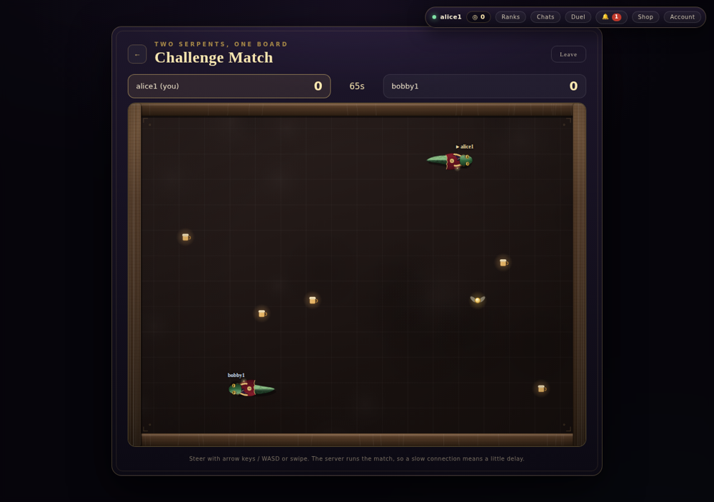
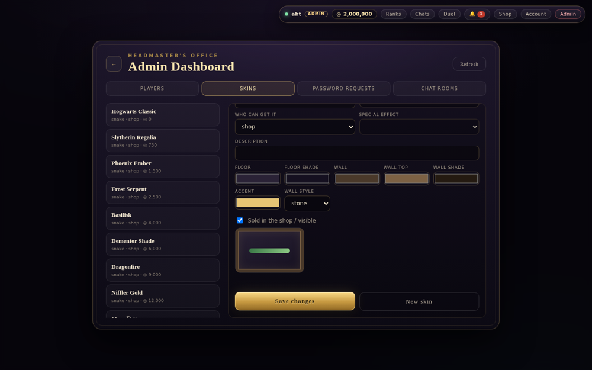

# 🐍 Hogwarts Serpent

A wizarding snake adventure for the browser — campaign trials, an endless
**Hell Night** mode, a coin shop with snake and board skins, global leaderboards,
private chat rooms, and live **challenge matches** where two players share one
board.

> **License:** source-available for study and local play, **not for sale or
> commercial use**. See [LICENSE](LICENSE). Unofficial fan project, not
> affiliated with Warner Bros. or J.K. Rowling.

| | |
| --- | --- |
|  |  |
|  |  |

## Features

- **Three difficulty modes** — Easy (walls wrap), Difficult (walls are fatal) and
  Hell Night (endless, fast, the only mode that pays coins). The mode is locked
  for the whole game.
- **Leaderboards** — separate Easy, Difficult and Hell boards plus a Duels ladder.
  The current Hell top 3 wear the *champion* skins.
- **Shop** — snake skins and board skins bought with coins. Special-effect skins
  (Aegis: survive a hit; Venom: stun guardians with <kbd>Space</kbd>; Luck: double
  Hell coins) are granted by the admin or won on the leaderboard.
- **Private chat rooms** — create one for 1,000 coins, add players, leave any time.
  Admins can read every room (players are told so).
- **Challenge match** — two players, one larger board, 75 seconds, most points
  wins. The server referees; both browsers run the same deterministic simulation
  with client-side prediction so it stays smooth.
- **Accounts** — salted PBKDF2 password hashes, HttpOnly sessions, CSRF tokens,
  rate limiting, and an admin-assisted *forgot password* flow.
- **Admin dashboard** — players, skin editor (new snake/board skins with colour
  pickers), password-reset requests and a chat-room monitor.



## Run it locally

Requires **Python 3.10+**.

```bash
git clone <your-fork-or-copy-of-this-repo>
cd hogwarts-serpent
python -m venv .venv && source .venv/bin/activate    # Windows: .venv\Scripts\activate
pip install -r requirements.txt
python server.py
```

Open <http://127.0.0.1:8123> (or whatever `HPS_HOST` / `HPS_PORT` say), create an
account and play. The SQLite database is created automatically in `./data/`.

### Configuration (environment variables)

| Variable | Default | Purpose |
| --- | --- | --- |
| `HPS_HOST` | `127.0.0.1` | Interface to listen on |
| `HPS_PORT` | `8123` | Port |
| `HPS_DATA` | `./data` | Where `game.db` is stored |
| `HPS_SECURE_COOKIE` | `0` | Set `1` behind HTTPS |
| `HPS_TRUST_PROXY` | `0` | Set `1` only behind a trusted reverse proxy |
| `HPS_ADMIN_USER` | `aht` | Admin username created on a brand-new database |
| `HPS_ADMIN_PASSWORD` | *(unset)* | Your own admin password for a brand-new database |

**Admin account.** On a brand-new database an admin user is created. The
maintainer's credential exists in the code only as a salted one-way hash. To use
the admin dashboard on your own copy, set `HPS_ADMIN_PASSWORD` **before the first
start** (delete `data/` to start over), then sign in with `HPS_ADMIN_USER`.
Change the password under *Account → Change Password* on any shared deployment.

## Project layout

```
server.py            Flask API + SQLite (auth, shop, runs, leaderboards, chat, duels)
index.html           Single-page UI
styles.css           Styling
skins.json           Seed skins for a new database
src/                 Browser code
  game.js            Core game loop and rules
  render.js          Canvas renderer (snakes, boards, particles)
  duel.js            Deterministic duel simulation + prediction (mirrors server.py)
  match.js           Challenge-match lobby, polling and results
  social.js          Leaderboards, chat rooms, alerts
  shop.js / skins.js Skin shop and skin catalog
  admin.js           Admin dashboard
  net.js / ui.js ... networking, screens, input, audio, saves
deploy/              Example systemd / Caddy / backup files
DEPLOY.md            Hosting guide (Oracle Cloud, Tailscale Funnel, PythonAnywhere)
```

## How the duel stays in sync

`server.py` (`_match_tick`) and `src/duel.js` (`stepTick`) implement the same
rules with the same seeded random generator, so the server and both browsers
compute identical games from the same inputs. Players send only their steering
input; each browser predicts forward and replays the server's snapshots to correct
any difference. The server remains the referee for scores and the winner.

## Security notes

- Only `index.html`, `styles.css` and `src/*.js` are served; the server code,
  database and deploy files are never reachable by URL.
- Gameplay is client-side, so scores are capped by server-measured run time but
  are not fully cheat-proof.
- Never commit `data/` — it holds every player's account data (`.gitignore`
  already excludes it).

## Author & license

© 2026 Ahtsham. Source-available under the
[Non-Commercial Source-Available License](LICENSE) — study it, learn from it, play
it locally; don't sell it or use it commercially.
